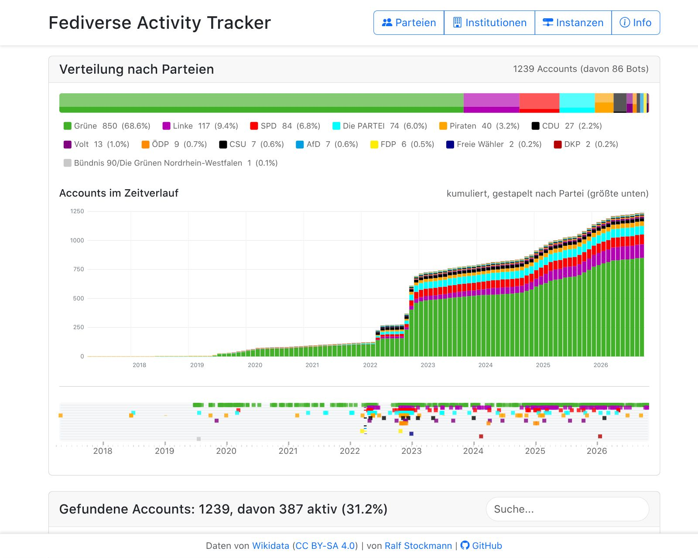
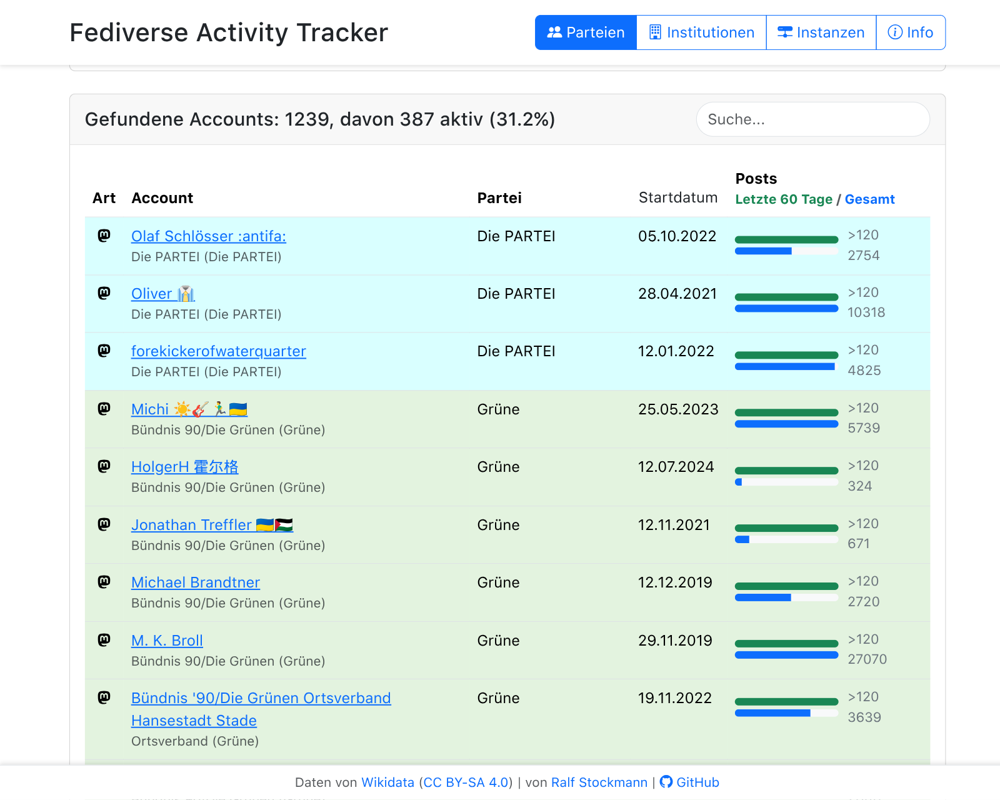
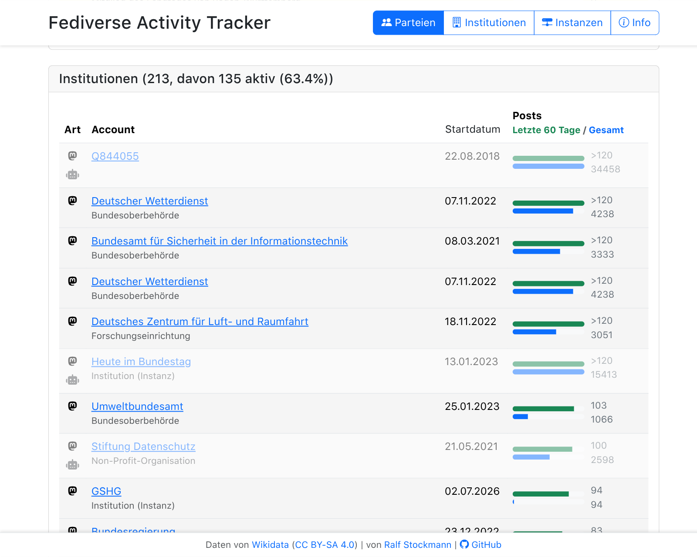
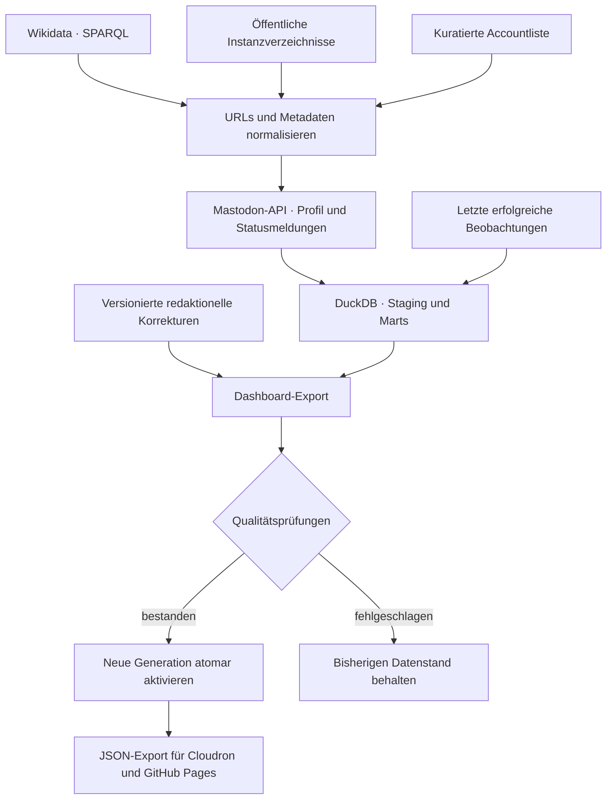

# Fedipol · Politik im Fediverse

Welche politischen Accounts sind im Fediverse vertreten – und wie aktiv sind sie?
**Fedipol** macht Politiker:innen, Parteien, Parteigliederungen und öffentliche
Institutionen sichtbar: mit Parteiverteilung, Account-Zeitverlauf und vergleichbaren
Aktivitätsanzeigen. Eine serverseitige Datenpipeline aktualisiert die Daten täglich.

**[Dashboard öffnen](https://fedipol.wolkenbar.de/)** ·
[GitHub-Pages-Version](https://rstockm.github.io/fedipol/) ·
[JSON-Daten](https://fedipol.wolkenbar.de/fedipol_data.json) ·
[Service-App & Quellcode](https://github.com/rstockm/fedipol/tree/service-app)



*Live-Aufnahme vom 5. November 2026. Die Zahlen ändern sich mit den Datenläufen.*

## Was das Dashboard bietet

- **Parteien im Vergleich:** farbige Verteilung mit Accountzahlen, Anteilen und
  Bot-Anzahl. Ein Klick auf einen Parteibalken oder Legendeneintrag filtert die Ansicht.
- **Accounts im Zeitverlauf:** monatlich kumulierte, nach Parteien gestapelte
  Accountzahlen. Der Hover zeigt den Zuwachs gegenüber dem Vormonat; der Parteifilter
  wird berücksichtigt.
- **Beitritts-Timeline:** einzelne Konten entlang ihres Erstellungsdatums entdecken;
  Marker verlinken auf die Profile.
- **Aktivität auf einen Blick:** Beiträge der letzten 60 Tage und Gesamtzahl mit
  getrennten Balken; aktive und inaktive Konten sind visuell unterscheidbar.
- **Suchen und sortieren:** Accounts und Institutionen per Textsuche eingrenzen;
  nach Startdatum, jüngster Aktivität oder Gesamtzahl der Beiträge sortieren.
- **In FediWings analysieren:** Der Button in Personen-/Parteizeilen öffnet den
  Account in [FediWings](https://rstockm.github.io/fediwings/) und startet dort
  die Reichweitenanalyse direkt. Dabei werden API-Anfragen an die Heimatinstanz
  des Accounts gesendet.
- **Institutionen und Instanzen:** eigene Tabellen für öffentliche Einrichtungen
  und die gefundenen Fediverse-Server.
- **Bot-Kennzeichnung:** automatisierte Konten werden markiert und abgeschwächt
  dargestellt, statt unbemerkt mit persönlichen Konten gleichgesetzt zu werden.
- **Offene Daten:** derselbe JSON-Export versorgt beide Frontends und kann für
  eigene Auswertungen abgerufen werden.

### Account-Aktivität



**So liest du die Tabelle:** Grün steht für die jüngste Aktivität, Blau für die
Gesamtzahl. Die Balken werden jeweils relativ skaliert; die Zahlen daneben sind
die Messwerte. Standardmäßig stehen die zuletzt besonders aktiven Konten oben.

<details>
<summary>Screenshot: öffentliche Institutionen</summary>



Auch Behörden und Forschungseinrichtungen lassen sich anhand derselben
Aktivitätskennzahlen erkunden. Ausgegraute Bot-Konten bleiben als solche erkennbar.

</details>

## Daten richtig einordnen

- **„Letzte 60 Tage“ ist gedeckelt:** Pro Konto werden höchstens drei API-Seiten
  mit je 40 Statusmeldungen gelesen. Bei Erreichen von 120 zeigt die Oberfläche
  derzeit `>120`. Das bedeutet: Die Zählgrenze ist erreicht – nicht, dass die
  tatsächliche Zahl exakt bekannt ist oder zwingend über 120 liegt.
- **„Gesamt“ stammt aus dem Profil:** Es ist der von der jeweiligen Instanz
  gelieferte Beitragszähler, keine von Fedipol archivierte Sammlung aller Beiträge.
- **Startdatum ist das Erstellungsdatum des Kontos**, nicht Amtsantritt,
  Parteieintritt oder das Datum der Aufnahme in Fedipol.
- **Der Zeitverlauf ist keine historische Bestandsmessung:** Er ordnet die heute
  erfassten Konten nach ihrem Erstellungsdatum. Später gelöschte oder nicht erfasste
  Konten fehlen; bei Umzügen ist das Datum des jeweiligen Kontos maßgeblich.
- **Die Auswahl ist nicht vollständig oder verifiziert:** Wikidata, öffentliche
  Verzeichnisse und manuelle Ergänzungen können veraltet sein. Eine Zuordnung
  über eine Parteiinstanz ist keine individuelle Prüfung einer Parteimitgliedschaft.
- **Bot-Erkennung ist eine Heuristik:** Das Mastodon-Bot-Flag und Schlüsselwörter
  in der Profilbeschreibung dienen als Hinweise, nicht als Echtheitsnachweis.
- **Täglich aktualisiert heißt nicht jedes Konto frisch:** Bei Netzfehlern oder
  API-Ratelimits können letzte erfolgreiche Beobachtungen übernommen werden.
  Der [Datenstatus](https://fedipol.wolkenbar.de/health/data) nennt die aktive
  Generation und die Anzahl veralteter Beobachtungen.

## Wie die ETL-Pipeline funktioniert

**ETL** steht für *Extract, Transform, Load*: Quellen abrufen, Daten vereinheitlichen
und einen geprüften Datenstand bereitstellen. Das passiert auf dem Server – nicht
im Browser der Besucher:innen. Der Cloudron-Scheduler startet den Nachtlauf
**täglich um 03:00 UTC**.



### 1. Quellen zusammenführen

- **Wikidata:** versionierte SPARQL-Abfragen finden politische Personen,
  Parteiorganisationen und Institutionen mit Mastodon-Adresse (`P4033`).
- **Instanzverzeichnisse:** öffentliche Verzeichnisse ergänzen die Auswahl, unter
  anderem von `gruene.social`, `linke.social`, `spd.social`, `die-partei.social`,
  `piraten-partei.social` sowie institutionellen Instanzen wie `social.bund.de`.
- **Kuratierte Liste:** manuell gepflegte Accounts ergänzen die automatischen Quellen.

URLs, Handles, Hostnamen und Parteien werden normalisiert; gleiche Profil-URLs
werden zusammengeführt. Fehlende Metadaten können aus anderen Quellen ergänzt werden.

### 2. Profile und Aktivität abrufen

Die Mastodon-API liefert Profil-ID, Erstellungsdatum, Gesamtbeitragszahl und
Bot-Hinweise. Anschließend werden die Statusmeldungen seitenweise auf das
60-Tage-Fenster geprüft, bis die Seitenbegrenzung erreicht ist oder keine weitere
relevante Seite verfügbar ist.

Feste Timeouts, begrenzte Wiederholungen mit Backoff und instanzbezogene
Parallelitätsgrenzen begrenzen Fehler und Last. Checkpoints protokollieren
Abrufresultate; bei fehlgeschlagener Anreicherung kann die letzte erfolgreiche
Beobachtung als veraltet übernommen werden.

### 3. Aufbereiten und prüfen

**DuckDB** hält Rohkandidaten und Beobachtungen im Staging und bereitet daraus
die Auswertungstabellen (*Marts*) auf. Versionierte Overrides können etwa
Bot-Markierungen korrigieren, Konten ausschließen oder ersetzte Profiladressen
festhalten. Qualitätsprüfungen kontrollieren den Exportvertrag, Zähler,
Bestandsveränderungen und den Anteil erfolgreicher Abrufe.

### 4. Sicher veröffentlichen

Nur ein geprüfter Lauf wird als neue, unveränderliche **Generation** veröffentlicht
und atomar aktiviert. Schlägt der Lauf fehl, bleibt der vorherige Stand verfügbar.
Ein Prozess-Lock verhindert überlappende Läufe. SQLite speichert Betriebszustand
und Laufprotokolle; Datenbank und JSON-Export gehören zur jeweiligen Generation.

## Architektur und Betrieb

| Bestandteil | Aufgabe |
| --- | --- |
| Statisches Frontend | HTML, CSS und JavaScript; lädt den aktiven JSON-Export |
| Django-Service-App | Liefert Dashboard, Datenexport und Status-Endpunkte |
| Python-ETL + DuckDB | Extraktion, Anreicherung, Transformation und Qualitätsprüfung |
| SQLite | Betriebszustand, Laufprotokolle und aktive Generation |
| Cloudron | Hosting, persistenter Speicher, Backups und täglicher Scheduler |

**Zwei Frontends, eine Datenpipeline:** Auf `fedipol.wolkenbar.de` werden Dashboard
und Backend gemeinsam ausgeliefert. GitHub Pages liefert eine statische Kopie
aus dem Branch `main`, die per CORS denselben Cloudron-Export lädt. Es gibt keine
zweite, unabhängige Datenberechnung.

| Öffentlicher Endpunkt | Inhalt |
| --- | --- |
| [`/fedipol_data.json`](https://fedipol.wolkenbar.de/fedipol_data.json) | Aktiver Dashboard-Datenstand |
| [`/manifest.json`](https://fedipol.wolkenbar.de/manifest.json) | Metadaten der aktiven Generation |
| [`/healthz`](https://fedipol.wolkenbar.de/healthz) | Dienst-, SQLite- und Generationsprüfung |
| [`/health/data`](https://fedipol.wolkenbar.de/health/data) | Datenaktualität und veraltete Beobachtungen |

```sh
curl -fsS https://fedipol.wolkenbar.de/fedipol_data.json -o fedipol_data.json
```

## Entwicklung und eigene Installation

### Statisches Frontend (`main`)

Kein Build-Schritt erforderlich. Aus einem lokalen Checkout:

```sh
python3 -m http.server 8000
node --test tests/*.test.cjs
```

Die Seite liegt dann unter `http://localhost:8000`. Daten werden vom Service
geladen; für lokale Browserzugriffe muss dessen CORS-Freigabe die lokale Origin
erlauben. Ohne diese Freigabe ist ein lokal gestarteter Service die Alternative.

### Service-App und ETL (`service-app`)

Der Backend-Code liegt auf einem eigenen Branch. Für einen separaten Checkout:

```sh
git clone --branch service-app https://github.com/rstockm/fedipol.git fedipol-service
cd fedipol-service
python3 -m venv .venv
.venv/bin/python -m pip install -e '.[dev]'
make check       # Lint und Backend-Tests
make migrate     # Lokale Betriebsdatenbank anlegen
make etl-smoke   # Echter Quellenabruf mit begrenzter Anreicherung
make serve       # Django-App unter http://127.0.0.1:8000
```

Voraussetzung: Python **3.12 oder neuer**. `make etl` führt den vollständigen
Datenlauf aus; er kann länger dauern und unterliegt den Ratelimits der Quellen.
Für Offline-Pipeline-Tests gibt es Fixtures und simulierte HTTP-Antworten.

Weiterführende Dokumentation im Service-Branch:

- [Setup, Verzeichnisstruktur und Cloudron-Deployment](https://github.com/rstockm/fedipol/blob/service-app/README.md)
- [Architektur der Automatisierung](https://github.com/rstockm/fedipol/blob/service-app/ARCHITEKTUR-AUTOMATISIERUNG.md)
- [Hosting-Entscheidung](https://github.com/rstockm/fedipol/blob/service-app/docs/adr/ADR-0002-dashboard-hosting.md)
- [Quellkonfiguration](https://github.com/rstockm/fedipol/blob/service-app/config/sources.yaml)
- [Redaktionelle Overrides](https://github.com/rstockm/fedipol/blob/service-app/config/account_overrides.yaml)

## Fehlende Politiker:innen? Bitte in Wikidata ergänzen

**Politische Stammdaten bitte direkt in Wikidata nachtragen und korrigieren –
nicht als Aufnahmewunsch an Fedipol schicken.** Dazu gehören insbesondere die
Mastodon-Adresse, Parteizugehörigkeit und das politische Amt einer Person.
Fedipol liest diese Angaben automatisiert ein; die Korrektur an der Quelle macht
sie zugleich für andere Projekte nutzbar. Ein GitHub-Issue ersetzt diesen Schritt
nicht.

### Schritt für Schritt

1. **Person suchen:** Öffne [Wikidata](https://www.wikidata.org/) und suche nach
   der Person. Prüfe anhand von Beschreibung und Lebensdaten, ob es der richtige
   Eintrag ist. Nicht für ein fehlendes Konto einen zweiten Personeneintrag anlegen.
   Zum Bearbeiten kannst du dich mit einem Wikimedia-Konto anmelden; grundlegende
   Hilfe bietet die [Wikidata-Einführung](https://www.wikidata.org/wiki/Help:Introduction/de).
2. **Mastodon-Adresse ergänzen:** Suche im Personeneintrag unter „Aussagen“ nach
   **[Mastodon-Adresse (P4033)](https://www.wikidata.org/wiki/Property:P4033)**.
   Fehlt die Eigenschaft, füge sie über „Aussage hinzufügen“ hinzu. Trage den
   vollständigen Handle im Format `benutzername@instanz.example` ein – ohne
   führendes `@`, ohne `https://` und ohne Profilpfad. Beispiel für das Format:
   Aus `https://instanz.example/@beispiel` wird `beispiel@instanz.example`.
3. **Politische Angaben prüfen:** Für die automatische Auswahl genügt die
   Mastodon-Adresse allein nicht. Die Person braucht eine passende Parteiangabe,
   üblicherweise **[Mitglied von politischer Partei (P102)](https://www.wikidata.org/wiki/Property:P102)**,
   und ein von der Abfrage erfasstes aktuelles
   **[öffentliches Amt (P39)](https://www.wikidata.org/wiki/Property:P39)**,
   etwa ein Bundestags- oder Landtagsmandat. Partei und Amt werden als verlinkte
   Wikidata-Objekte eingetragen, nicht als frei erfundener Text.
4. **Belege und Zeitangaben hinzufügen:** Belege die Aussagen mit zuverlässigen,
   öffentlich zugänglichen Quellen, zum Beispiel einer offiziellen Parlamentsseite
   oder einer persönlichen Website, die das Mastodon-Profil verlinkt. Trage
   bekannte Amtszeiten sachgerecht ein. Abgelaufene Ämter nicht als aktuell
   darstellen, nur damit ein Konto in Fedipol erscheint.
5. **Umzüge korrekt festhalten:** Ergänze bei einem Kontowechsel die neue
   Mastodon-Adresse. Eine nicht mehr gültige Adresse kann mit dem Qualifikator
   **[Endzeitpunkt (P582)](https://www.wikidata.org/wiki/Property:P582)** versehen
   werden; solche beendeten Adress-Aussagen berücksichtigt die Fedipol-Abfrage
   nicht. Historische Angaben nicht einfach in die neue Adresse umschreiben.
6. **Speichern und nächsten Datenlauf abwarten:** Veröffentliche deine Änderungen
   in Wikidata. Nach deren Verfügbarkeit im Wikidata Query Service kann Fedipol
   sie im nächsten erfolgreichen Nachtlauf übernehmen. Das Dashboard aktualisiert
   sich nicht unmittelbar nach einer Wikidata-Bearbeitung.

**Wichtig:** Nur zutreffende, belegbare Angaben ergänzen. Die Aufnahme hängt von
den [Auswahlkriterien der SPARQL-Abfrage](https://github.com/rstockm/fedipol/blob/service-app/config/queries/parliament.sparql)
und einem erfolgreichen Profilabruf ab; ein Wikidata-Nachtrag garantiert keine
sofortige Anzeige. Nicht jede politisch aktive Person erfüllt die aktuelle Auswahl.

Zur Abgrenzung: Die **Wikidata-basierten Stammdaten** werden dort gepflegt.
Zusätzlich entdeckt die aktuelle Pipeline Konten über Instanzverzeichnisse und
kuratierte Ergänzungen. Beitragszahlen, Konto-Erstellungsdatum und Bot-Hinweise
werden von der Mastodon-API abgerufen, nicht aus Wikidata.

### Technische Fehler melden

Ist der Wikidata-Eintrag korrekt, aber Fedipol übernimmt oder zeigt ihn trotzdem
falsch an? Dann bitte ein [GitHub-Issue](https://github.com/rstockm/fedipol/issues)
mit **Wikidata-Link, Profil-URL sowie erwartetem und beobachtetem Verhalten**
anlegen. Bei Darstellungsfehlern helfen zusätzlich Screenshot, Browser und die
verwendete Dashboard-Adresse. Falsche Bot-Markierungen oder Aktivitätswerte
können ebenfalls dort gemeldet werden; dafür ist Wikidata nicht die Datenquelle.

## Lizenz und Quellen

Der Programmcode steht unter der [MIT-Lizenz](LICENSE). Daten stammen aus
[Wikidata](https://www.wikidata.org/), öffentlichen Instanzverzeichnissen,
Mastodon-Profilen und kuratierten Ergänzungen; für die Weiterverwendung sind die
jeweiligen Quellenbedingungen zu beachten. Wikidatas strukturierte Daten stehen
unter [CC0](https://www.wikidata.org/wiki/Wikidata:Licensing).

Ein Projekt von [Ralf Stockmann](https://chaos.social/@rstockm).
